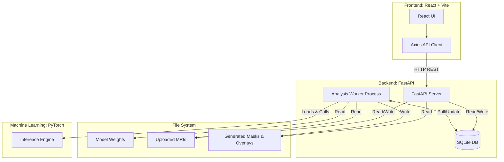
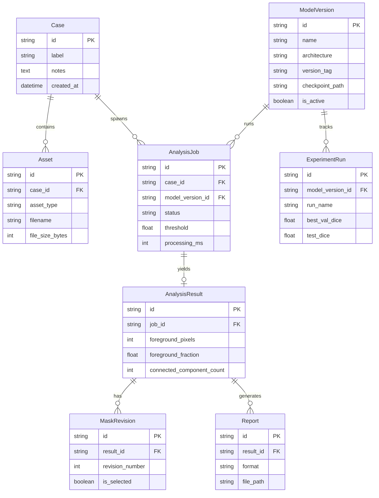

# Architecture & Database Schema

## System Architecture

NeuroSeg AI operates as a decoupled, local-first system consisting of three main layers:

### Components:
1. **Frontend**: A React single-page application communicating via REST. Uses local proxy to avoid CORS issues in development.
2. **FastAPI API**: Handles all HTTP requests, image validation, case management, and enqueues jobs by writing to the database.
3. **Background Worker**: A standalone Python process that polls the database for queued jobs. It claims a job atomically (using `FOR UPDATE SKIP LOCKED` equivalent logic logic adapted for SQLite/application layer), runs PyTorch inference, and writes results to disk and DB.
4. **Local File System**: `data/` directory stores raw images, model checkpoints, and result artifacts. 

---

## Database Schema

